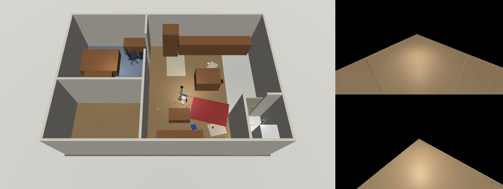

# homebody

A house robot you can build for about $1,250, and a simulation of the home it works in.

It's designed for real chores: picking trash and clothes up off the floor, carrying laundry to the
laundry room, opening the lever-handle door, loading the washer and dryer, and keeping itself charged
by backing onto its dock. The design copies the idea behind Hello Robot's Stretch, built from cheap
parts: a vertical lift plus a telescoping arm, so heavy loads push along slides instead of twisting a
joint.


The earlier version, a 0.6 m walking humanoid, is kept at the tag `humanoid-v1`.

## The robot

| | |
|---|---|
| Base | two hub motors from a used hoverboard (reflashed with hoverboard-firmware-hack-FOC), casters, anti-tip outrigger wheels at ±32 cm, 12 kg steel ballast, a tote on the deck for carrying things |
| Reach | a 1.6 m mast with a counterbalanced belt lift (the arm's height runs 0.22 to 1.52 m) and a telescoping arm reaching 0.54 m out to the side. The gripper reaches from the floor to about 1.4 m |
| Hand | a three-axis wrist (yaw, pitch, roll) and parallel-jaw soft gripper on Feetech bus servos, with a camera in the palm |
| Senses | lidar (RPLIDAR C1), pan/tilt head camera, palm camera, IMU, bumper, 4 cliff sensors, battery monitor, dock beacon, every motor's encoder, load and temperature |
| Power | 36 V 10S2P Li-ion (180 Wh). About 19 W idle, so 9 h waiting; 30 W driving |
| Brain | runs on your desktop GPU over Wi-Fi; a Raspberry Pi 5 on the robot handles motors, sensors and safety |
| Mass, size | 26 kg, 0.5 m long, 0.64 m wide at the outriggers (fits an 82 cm doorway), 1.68 m tall |

Every number lives in [homebody/spec.py](homebody/spec.py). The simulator and the hardware runtime both
read it, so the robot you train is the robot you build. Parts list, power, safety and known gaps are in
[DESIGN.md](DESIGN.md).

## The home

[homebody/home.py](homebody/home.py) holds the floor plan:
- a bedroom with bed, desk, rolling desk chair, wardrobe, trash can, laundry basket and the dock
- an open living room and kitchen
- a laundry room behind a latching lever-handle door, with a stacked washer and dryer and a bucket of
  laundry pods

It's a plausible stand-in; a phone lidar scan of the real rooms replaces it.



What the robot has to cope with:

- **Floors:** uneven (about 3 mm of bumps and up to 0.5° of tilt, regenerated every episode), carpet in
  the bedroom, tile in the laundry room, rugs, rubber mats, wet and dusty spots, door sills, and cables.
  `terrain_level` runs from 0 (lab floor) to 1 (ordinary home) and higher.
- **Things that move:** the desk chair rolls away when bumped, and clothes are floppy (a grid of
  fabric patches on loose joints).
- **Doors:** the laundry door stays latched until a lever is pressed past 30°. The washer and dryer
  doors have magnetic catches.
- **Power:** motors draw from the pack, and the hub motors weaken as it sags. Servos overheat if
  stalled. Below the BMS cutoff, everything stops.
- **People:** `push_rate` adds accidental shoves near the top of the mast.
- **Damage:** hard knocks break specific parts (wrist, palm camera, head, lidar, mast). A broken wrist
  or mast, tipping over, or a dead battery ends the episode.

## Use it

```bash
pip install -r requirements.txt
python scripts/smoke_test.py           # 8 physical checks, ~1 min
python scripts/view.py                 # drive it yourself (keys printed on start)
python scripts/record.py               # the scripted demo above, to media/demo.mp4
```

```python
from homebody import HomebodyEnv, EnvConfig
env = HomebodyEnv(EnvConfig(reward="chores", cameras=(96, 128)))
obs, info = env.reset(seed=0)          # obs["state"]: 255 sensor readings (env.obs_names), plus camera images
obs, reward, dead, timeout, info = env.step(env.action_space.sample())   # 10 motor commands
```

The commands are what the motor drivers take:
- **Hub motors:** duty cycle.
- **Lift and telescope steppers:** speed.
- **Six bus servos:** target positions. Each servo runs its own fast position loop; `servo_mode="pwm"`
  gives raw duty instead, which makes servos chatter and overheat from a 20 Hz brain, in sim as on
  hardware.

`info` carries ground truth (room, position, distance to the dock, where every item is, door angles,
part damage) and is never part of the observation.

Rewards are pluggable:
- `survival`: staying alive
- `energy`: plus stored energy
- `chores`: plus one per item put where it belongs (trash in the trash can; clothes in the basket or
  washer; pods in the washer)
- `dock_shaped`
- or any function of `(info, prev_info)`

The sim runs at about 90 control steps per second on one CPU core, 4.5x real time.

## What's proven so far (`scripts/smoke_test.py`)

| Check | Result |
|---|---|
| Drives | 1 m in 3 s at 29 W |
| Lift + counterbalance | the arm rises to 1.37 m and holds through a power cut |
| Picks trash off the floor into the deck tote | yes |
| Opens the laundry door: presses the lever to unlatch, pushes it open | yes |
| Charges on the dock | yes; an empty battery is death |
| Survives an 80 N shove at the top of the mast, lift up and arm out | 0/10 tips. A 200 N shove (a firm adult push) still tips it |
| Floors are uneven and varied | yes |

Not yet: grasping floppy clothes reliably (the open fingers land on the cloth instead of pinching it),
loading the washer, the dryer transfer and docking from across the room. Those are the training
problems.

## Implanting the brain

[homebody/interface.py](homebody/interface.py) defines `Body`, with `SimBody` and a `RobotBody`
skeleton. The skeleton covers the servo bus, with TODOs for the hub motors, stepper drivers and sensor
drivers. Moving a trained brain to the robot is `RobotBody(...).run(brain)`.
