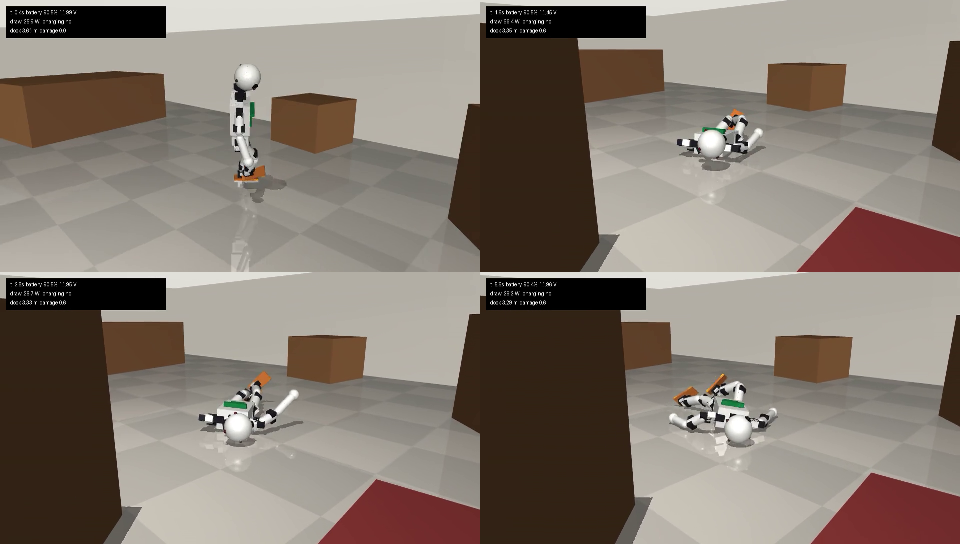

# homebody

A small humanoid robot you can build for about $1,040, and a simulated home it has to survive in.

There are no "walk", "sleep" or "charge" commands. The brain gets only what the robot's own sensors
report, and its only outputs are 20 muscle activations: one PWM duty cycle per servo, the same number
the physical robot writes to each motor. Every movement costs battery. When the battery runs out,
the robot goes limp and dies. The only way to get energy back is to walk to the charging dock and
stand with one foot on each copper plate.

Successor to [humanoid-civilization](https://github.com/neomorrison/humanoid-civilization) (learned
high-level behaviour) and [malecns-test](https://github.com/neomorrison/malecns-test) (learned
locomotion under a fly brain). This one starts at the bottom: muscles, a body and a battery.



## The robot

| | |
|---|---|
| Height, mass | about 0.62 m, 2.74 kg |
| Muscles | 20 Feetech bus servos in open-loop PWM mode: 8 x STS3250 (4.9 N m) on hip pitch/roll, knees and ankle pitch; 12 x STS3215-12V (2.9 N m) on hip yaw, ankle roll, arms (3 each) and neck (2) |
| Brain computer | Raspberry Pi 5, 50 Hz control loop |
| Senses | joint angle, speed, load and temperature from every servo; BNO085 IMU; 4 force sensors per sole; pack voltage and current; charging flag; 4 IR photodiodes on the head that pick up the dock's beacon; head camera (optional in sim) |
| Battery | 3S 18650 Li-ion, 3.5 Ah, 38 Wh, BMS cutoff at 9.0 V |
| Endurance (sim) | about 9 W to hold a crouch (4.4 h); 30 to 40 W while thrashing |
| Charging | dock with two copper plates and an IR beacon; copper pads on the soles behind an ideal-diode bridge, so either foot works on either plate; 2 A CC/CV, about 1.1 A net into the pack while standing |

Every number comes from [homebody/spec.py](homebody/spec.py). The simulator and the hardware runtime both
read that file, so the body you train is the body you build. Full parts list, wiring and the dock
design are in [DESIGN.md](DESIGN.md).

## The world

A 6 x 5 m room with walls, six pieces of furniture, a rug with different friction and the dock against
a wall. The layout, the starting position, the initial charge, masses (±10%), floor friction (±25%)
and servo strength (-15%/+5%) are reshuffled every episode so that a brain cannot memorise one room
or one body.

The simulation models what kills a real robot:

* **Muscles are DC motors.** Torque = stall torque x duty x (battery voltage / 12 V) minus back-EMF,
  current-limited. A sagging battery makes the robot weaker.
* **Battery.** Li-ion open-circuit voltage curve, internal resistance, coulomb counting, BMS cutoff.
  Below 9.0 V under load, every motor goes limp.
* **Heat.** Each servo has a winding thermal model; above 70 C the firmware cuts it out until it cools.
  Stalling a joint against something works for seconds, not minutes.
* **Damage.** Hard impacts on anything other than feet and hands accumulate; past a limit the robot is broken.
* **Charging.** Power flows only when each sole rests on a different plate for 0.5 s. A foot bridging
  both plates is refused, as the real dock would.

## Use it

```bash
pip install -r requirements.txt
python scripts/smoke_test.py                        # 6 physical sanity checks, ~3 s
python scripts/view.py --brain hold                 # live viewer: posture reflex
python scripts/view.py --brain babble --start lying # random muscle twitches
python scripts/record.py --brain babble --out media/babble.mp4
```

```python
from homebody import HomebodyEnv, EnvConfig
env = HomebodyEnv(EnvConfig(reward="survival", capacity_scale=0.05))
obs, info = env.reset(seed=0)            # obs: 125 sensor readings, names in env.obs_names
obs, reward, dead, timeout, info = env.step(env.action_space.sample())   # 20 duty cycles
```

`info` carries ground truth (position, distance to the dock, damage, energy used and charged) for
analysis and critics; it is never in the observation. Rewards are pluggable: `survival` (only staying
alive), `energy` (plus stored energy) and `dock_shaped` (plus progress to the dock and staying upright),
or pass any function of `(info, prev_info)`.

The simulator runs about 680 control steps per second on one CPU core (14x real time).

## Implanting the brain

A brain is any function from the 125-number observation to 20 duty cycles. [homebody/interface.py](homebody/interface.py)
defines `Body` with two implementations: `SimBody` and `FeetechBody` (the servo bus over USB). Moving a
trained brain to the robot is `FeetechBody(port).run(brain)`. The servo side of `FeetechBody` is written;
the sensor drivers are TODO until the hardware exists.

## Status

Built: the robot model, the world, the power system, the hardware interface skeleton, smoke tests.
Not built yet: any learned brain. That is the next decision (see DESIGN.md, "What next").
