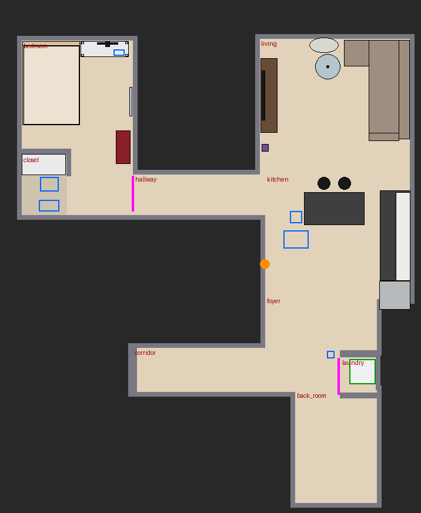
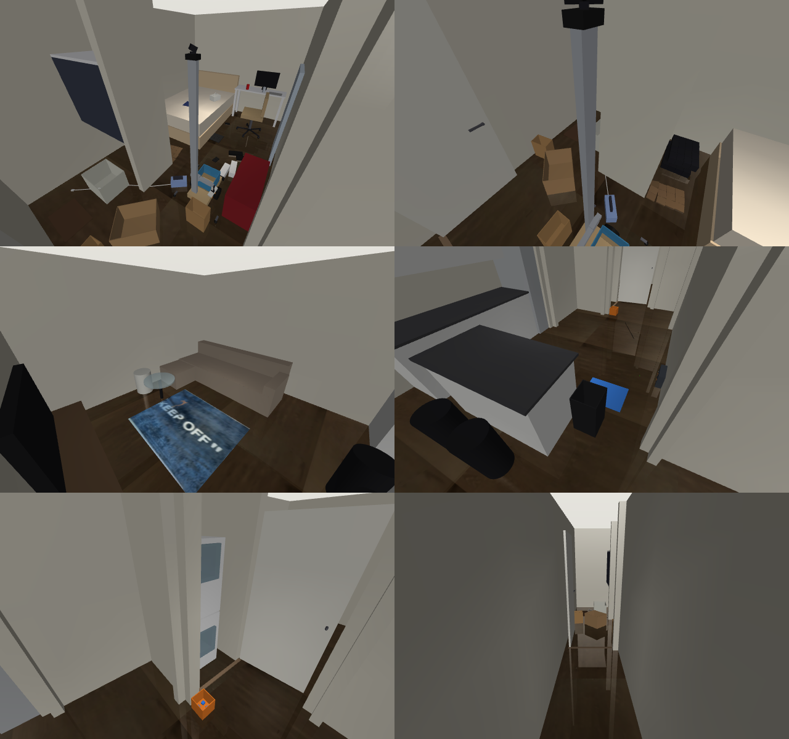

# homebody

A house robot you can build for about $1,200 (plus a $90 kit of helpers for the house), and a simulation of the home it works in.

**Watch it try the chores: [neomorrison.github.io/homebody](https://neomorrison.github.io/homebody/)**

It's designed for real chores: picking trash and clothes up off the floor, carrying laundry to the
laundry room, opening the lever-handle door, loading the washer and dryer, and keeping itself charged
by backing onto its dock. The design copies the idea behind Hello Robot's Stretch, built from cheap
parts: a vertical lift plus a telescoping arm, so heavy loads push along slides instead of twisting a
joint.


The earlier version, a 0.6 m walking humanoid, is kept at the tag `humanoid-v1`.

## The robot

| | |
|---|---|
| Base | two hub motors from a used hoverboard (reflashed with hoverboard-firmware-hack-FOC), spring-loaded casters (so both drive wheels keep their grip on uneven floors), anti-tip outrigger wheels at ±32 cm, 12 kg steel ballast, a tote on the deck for carrying things |
| Reach | a 1.8 m mast with a counterbalanced belt lift (the arm's height runs 0.12 to 1.62 m) and a telescoping arm reaching 0.54 m out to the side. The gripper reaches from the floor into the dryer drum |
| Hand | a three-axis wrist (yaw, pitch, roll) and parallel-jaw soft gripper on Feetech bus servos, with a camera in the palm |
| Senses | lidar (RPLIDAR C1), pan/tilt head camera, palm camera, IMU, bumper, 4 cliff sensors, battery monitor, dock beacon, every motor's encoder, load and temperature |
| Power | 36 V 10S2P Li-ion (180 Wh). About 19 W idle, so 9 h waiting; 30 W driving |
| Brain | runs on your desktop GPU over Wi-Fi; a Raspberry Pi 5 on the robot handles motors, sensors and safety |
| Mass, size | 26 kg, 0.5 m long, 0.64 m wide at the outriggers (fits your 1 m hallway and doorways), 1.88 m tall |

Every number lives in [homebody/spec.py](homebody/spec.py). The simulator and the hardware runtime both
read it, so the robot you train is the robot you build. Parts list, power, safety and known gaps are in
[DESIGN.md](DESIGN.md).

## The home: your apartment, recreated from your phone scan

The sim's home is a recreation of the owner's apartment, measured from a LiDAR scan taken with the
free 3d Scanner App on an iPhone Pro (2026-10-19). `scripts/import_scan.py` squares the scan to the
walls and turns it into a 4 cm height map ([homebody/assets/home_scan.npz](homebody/assets/home_scan.npz)),
which was used to measure the rooms. [homebody/home.py](homebody/home.py) rebuilds them cleanly: walls
as boxes around the room outlines, and furniture as simple solids where the scan put it (bed, desk,
closet, sofa, coffee table, TV stand, kitchen island, counters, fridge, stools). The floor and the
living-room rug use textures cut from the scan's photos.

A recreation instead of the raw scan mesh keeps contacts clean (no scanned lumps or holes, and no
clutter baked into the walls), and lets every episode vary colours, lighting and the movable furniture
(`EnvConfig(randomize_look=True)`), so a camera-based brain learns the room rather than one exact
picture of it.

It holds the bedroom with its walk-in closet, the 1 m hallway, the living room and kitchen, the foyer,
and the laundry closet with a stacked 24-inch washer and dryer. On top sit simulated versions of what
the robot operates, where they were measured:

- **Machines:** washer and dryer (door centres at 0.5 m and 1.55 m, measured from the scan).
- **Doors:** the bedroom door (lever latch), and the laundry closet door (knob and magnetic catch,
  standing in for the real louvered folding doors).
- **Containers and zones:** the kitchen trash can, a recycling spot beside it, the laundry basket
  and a shoe rack in the closet, a tray for the iron on the desk, and the head of the bed for
  pillows.
- **Also:** the charging dock on the kitchen wall by the foyer, the rolling desk chair, and the
  living-room rug.

The owner's real clutter comes back as movable items, starting where it was scanned
([homebody/items.py](homebody/items.py)):

| Item | Starts | Belongs |
|---|---|---|
| Takeout bag (with a handle loop) | on the bed | kitchen trash can |
| 2 aluminium cans | on the desk | recycling |
| 2 paper bags, a cardboard box (hollow, pinch a wall) | by the bedroom door | recycling |
| 2 shirts, jeans, 2 socks (floppy patch grids) | floor and bed | laundry basket or washer |
| Sneakers, slides | bedroom floor | shoe rack |
| 2 pillows (soft) | stacked at the foot of the bed | head of the bed |
| Clothing iron with its cord (linked segments) | on the floor, cord strung out | its tray on the desk |
| 4 laundry pods | in the pod bucket | washer |

`scatter=True` puts the clutter anywhere on free floor instead.





What else the robot has to cope with:

- **Floors:** small bumps and a slight tilt (regenerated every episode), floor friction from laminate
  to hardwood, rugs, rubber mats, wet and dusty spots, sills in the doorways, cables.
- **Movers:** the desk chair rolls away when bumped.
- **Power:** motors draw from the pack, and the hub motors weaken as it sags. Servos overheat if
  stalled. Below the BMS cutoff, everything stops.
- **People:** `push_rate` adds accidental shoves near the top of the mast.
- **Damage:** hard knocks break specific parts. A broken wrist or mast, tipping over, or a dead battery
  ends the episode.

## Use it

```bash
pip install -r requirements.txt
python scripts/smoke_test.py           # 8 physical checks, ~1 min
python scripts/view.py                 # drive it yourself around your home (keys printed on start)
python scripts/record.py               # the scripted demo above, to media/demo.mp4
python scripts/record_tasks.py         # record each task attempt to docs/videos, results to docs/tasks.json
python scripts/build_site.py           # rebuild the GitHub Pages site in docs/
python scripts/import_scan.py scans/<date>/textured_output.obj   # after a new scan
```

```python
from homebody import HomebodyEnv, EnvConfig
env = HomebodyEnv(EnvConfig(reward="chores", cameras=(96, 128)))
obs, info = env.reset(seed=0)          # obs["state"]: 255 sensor readings (env.obs_names), plus camera images
obs, reward, dead, timeout, info = env.step(env.action_space.sample())   # 10 motor commands
```

The commands are what the motor drivers take:
- **Hub motors:** duty cycle.
- **Lift and telescope steppers:** speed.
- **Six bus servos:** target positions. Each servo runs its own fast position loop; `servo_mode="pwm"`
  gives raw duty instead, which makes servos chatter and overheat from a 20 Hz brain, in sim as on
  hardware.

`info` carries ground truth (room, position, distance to the dock, where every item is, door angles,
part damage) and is never part of the observation.

Rewards are pluggable:
- `survival`: staying alive
- `energy`: plus stored energy
- `chores`: plus one per item put where it belongs (see the table above)
- `dock_shaped`
- or any function of `(info, prev_info)`

The sim runs at about 48 control steps per second on one CPU core with all 22 items out (2.4x real
time).

## What's proven so far, in your apartment

`scripts/smoke_test.py`:

| Check | Result |
|---|---|
| Drives down the hallway | 0.91 m in 3 s at 26 W |
| Lift reaches dryer height, holds through a power cut | arm at 1.57 m (the dryer door centre is 1.55 m) |
| Picks a can off the foyer floor into its tote | yes (the sneaker and slides work too) |
| Pulls the laundry closet door off its catch | 13° after a 20 cm pull |
| Charges on its dock | yes; an empty battery is death |
| Survives an 80 N shove at the mast top, lift up and arm out | 0/8 tips. A 200 N shove still tips it about 6 times in 8 |
| All 22 items start in the house, none fall through | yes |

`scripts/record_tasks.py` (videos on the [site](https://neomorrison.github.io/homebody/)) adds:
reaching into the dryer drum at 1.52 m, backing onto the dock from 1.2 m to charge at 1.9 A, and
the grasps below. `scripts/grasp_check.py` runs each one over several seeds and random orientations.

| Item | How | Check |
|---|---|---|
| Sock | jaws close across one patch, fingertips 1 mm off the floor | 6/6 into the tote |
| Can, sneaker, slides | jaws close across the narrowest side | 3/3 to 5/5 each |
| Paper bag | too big for the tote: pinch the rim from above, carry it | 6/6 carried |
| Can with drink in it | weigh it on the wrist, keep it upright in the hand | 10/10 cans sorted, no spills |

**Drinks.** Cans start 0 to 100% full (half are empty). After lifting, the robot tips its wrist 25°
and reads the wrist-pitch servo's load, the same number a real Feetech servo reports over its bus.
It reads within a few grams (a 66% full can: 248 g measured, 249 g true). Above 50 g there's drink
in it, so the can stays upright in the hand instead of being tossed in the tote. A can with liquid
tipped past 60° counts as a spill (`info["spills"]`, minus 2 in the `chores` reward); the old
blind toss spills a full can every time.

Not yet:
- **Grasps:** the cardboard box (0.6 kg hanging off one wall twists out of a 21 N pinch: grab a
  corner or flatten it), shirts and jeans, and the takeout bag (hook the handle).
- **Bigger chores:** loading the washer, the dryer transfer, the bedroom door from the hallway side,
  docking from across the apartment, and vacuuming (see [DESIGN.md](DESIGN.md)).

## Implanting the brain

[homebody/interface.py](homebody/interface.py) defines `Body`, with `SimBody` and a `RobotBody`
skeleton. The skeleton covers the servo bus, with TODOs for the hub motors, stepper drivers and sensor
drivers. Moving a trained brain to the robot is `RobotBody(...).run(brain)`.
